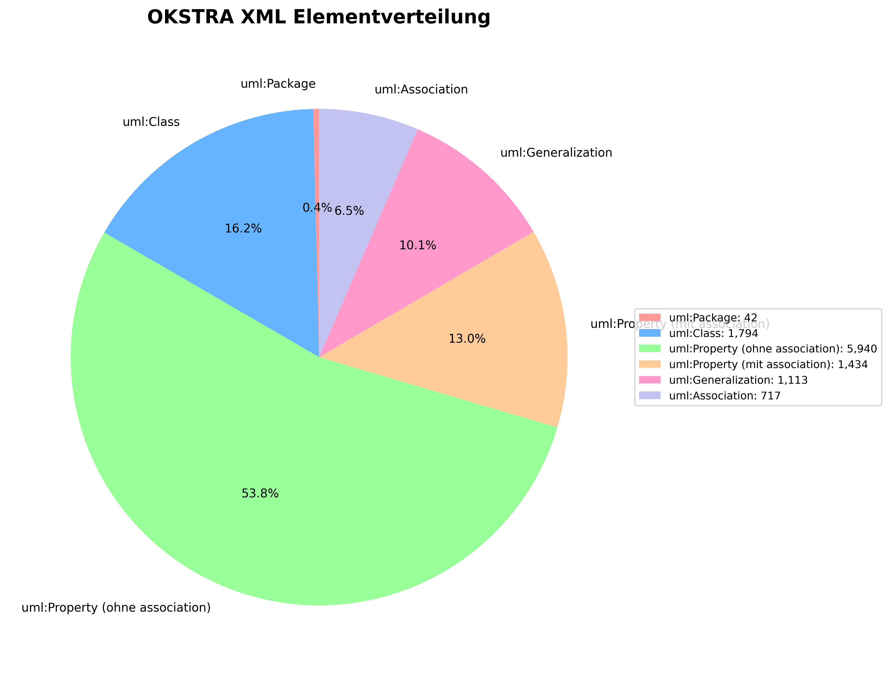

# OKSTRA XML Analyse

## Zusammenfassung

Diese Analyse zeigt die Verteilung der UML-Elemente in der Datei `okstra_short.xml`.

**Gesamtanzahl der Elemente:** 11,040

## Detaillierte Statistik

| Element-Typ | Anzahl | Prozentanteil |
|------------|--------|---------------|
| uml:Package | 42 | 0.38% |
| uml:Class | 1,794 | 16.25% |
| uml:Property (ohne association) | 5,940 | 53.80% |
| uml:Property (mit association) | 1,434 | 12.99% |
| uml:Generalization | 1,113 | 10.08% |
| uml:Association | 717 | 6.49% |

## Visualisierung

---

*Generiert am: analyze_okstra.py - OKSTRA Analyse-Tool*
